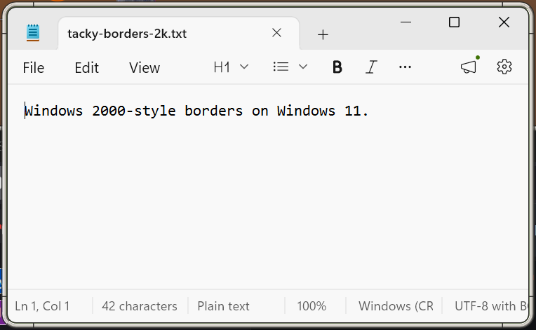

# tacky-borders-2k

A fork of [tacky-borders](https://github.com/luke-you/tacky-borders) that gives Windows 11 windows a Windows 2000-style frame.

## Install

Download `tacky-borders.exe` from [releases](https://github.com/jlennox-ai/tacky-borders-2k/releases) and run it. To build it yourself: `cargo build --release`.

## Configure

Right-click the tray icon and choose "Show Config" to open `%userprofile%/.config/tacky-borders/config.yaml`. Every option is documented in that file.

The Win2k style is the default. Set `border_style: Modern` for the original flat borders.

## Changes from tacky-borders

- **Win2k border style**: 3D bevel and corner separators, shaded from the border color.
- **Lower GPU memory use**: Drastically reduce GPU memory usage. ~1gb to ~50mb.
- **Borders no longer go missing**:
  - after the machine resumes from sleep
  - when an elevated window (such as a Windows Hello prompt) blocks a z-order change

## License

[MIT](LICENSE)

🤖 These enhancements were created by AI.
